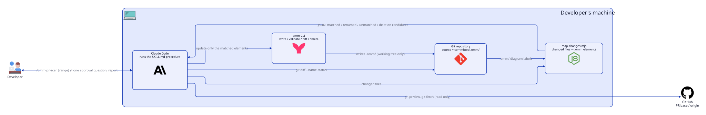

# omm-pr-scan

[English](README.md) | 日本語

[oh-my-mermaid](https://github.com/oh-my-mermaid/oh-my-mermaid) (`omm`) が作る `.omm/` のアーキテクチャ文書を、**プルリクエストで変わったファイルの分だけ**更新する [Claude Code](https://claude.com/claude-code) のスキルです。

omm に付いている `/omm-scan` は、毎回コードベース全体を読み直します。omm-pr-scan は、変わったファイルを担当する `.omm/` の要素を引き当て、その要素だけを更新し、図の更新前と更新後を見せます。PR で構成がどう変わったかを、図の差分から読めるようにするためです。

<picture>
  <source media="(prefers-color-scheme: dark)" srcset="assets/architecture-dark.svg">
  
</picture>

図のソースは `assets/architecture.d2` です ([D2](https://d2lang.com) で描画)。

## 動き

1. **前提を確かめる**: `omm` が入っていること、Git リポジトリの中であること、`.omm/` が `HEAD` にコミットされていること。欠けていれば、何をすればよいかを伝えて止まります。
2. **範囲を決める**: `A..B` か `A...B` の指定があればそれを使います。無ければ、開いている PR の向き先 (`gh pr view`)、次に `develop`、次に `main` の順です。ローカルのブランチが古くて範囲が広がらないよう、`origin/<base>` を優先します。
3. **変わったファイルを要素に引き当てる**: `scripts/map-changes.mjs` (Node の標準ライブラリだけ) が、`.omm/` のすべての `diagram.mmd` から、ノードのラベルに書かれたパス (`名前\nsrc/path/`) を読みます。変わったファイルを、視点ごとに一番長く一致するパスを持つ要素に当てます。テスト・ドキュメント・ロックファイル・静的ファイルは、既定で対象外です。
4. **1 回だけ聞く**: どの要素にも当たらないファイルと、担当するファイルが全部消えた要素は、足す案・消す案になります。番号つきで一覧にし、1 回の質問で確かめます。承認なしに要素を足したり消したりはしません。
5. **更新する**: 当たった要素の説明を、変わったコードに合わせて直します。`diagram.mmd` は 1 回の実行でファイルごとに 1 度しか書かないので、`omm diff` で実行前の図と比べられます。
6. **検証して報告する**: 書いた図ごとに `omm validate <要素>` を回し、会話に報告します。報告に載るのは、範囲、更新した要素、図ごとの更新前と更新後、`omm diff`、当たらなかったファイル、PR の本文に貼れる短い要約です。

stage・コミット・push はしません。omm のクラウドの操作もせず、`omm view` も起動せず、PR にコメントもしません。変更は作業ツリーに残ります。

## 必要なもの

- Claude Code
- [oh-my-mermaid](https://github.com/oh-my-mermaid/oh-my-mermaid) の CLI 0.2.0 (`npm install -g oh-my-mermaid`)
- Node.js 18 以上、Git
- `gh` (任意。PR の向き先を読むのに使う)
- `/omm-scan` で作って**コミット済みの** `.omm/`。omm-pr-scan は既存の `.omm/` を更新するだけで、視点は作りません。

## 入れ方

スキルのフォルダを Claude Code のスキルの置き場所に写します。

```bash
git clone https://github.com/reeschan/omm-pr-scan.git
cp -r omm-pr-scan/skills/omm-pr-scan ~/.claude/skills/
```

## 使い方

```text
/omm-pr-scan                          # 開いている PR の向き先 (または develop / main) から HEAD まで
/omm-pr-scan main..HEAD               # 範囲を指定する
/omm-pr-scan v1.2.0...feature/x       # 2 つの分岐点から
/omm-pr-scan --working                # 未コミットの変更も入れる
/omm-pr-scan --exclude 'src/generated/**'
```

## 限界

- 引き当てはファイルのパスで行います。振る舞いで分けた視点 (状態の遷移など) では、ラベルに書かれていないファイルの話をしていることがあり、その要素は更新されません。
- omm 0.2.0 は、空白を含む矢印のラベルをノードとして数えます (`omm validate` のノード数の warning と `omm diff`)。スキルはその warning を報告に載せるだけで、直しはしません。

## 開発

```bash
node --test skills/omm-pr-scan/scripts/map-changes.test.mjs
```

設計の仕様は `skills/omm-pr-scan/SPEC.md` です。

## ライセンス

[MIT](LICENSE)
