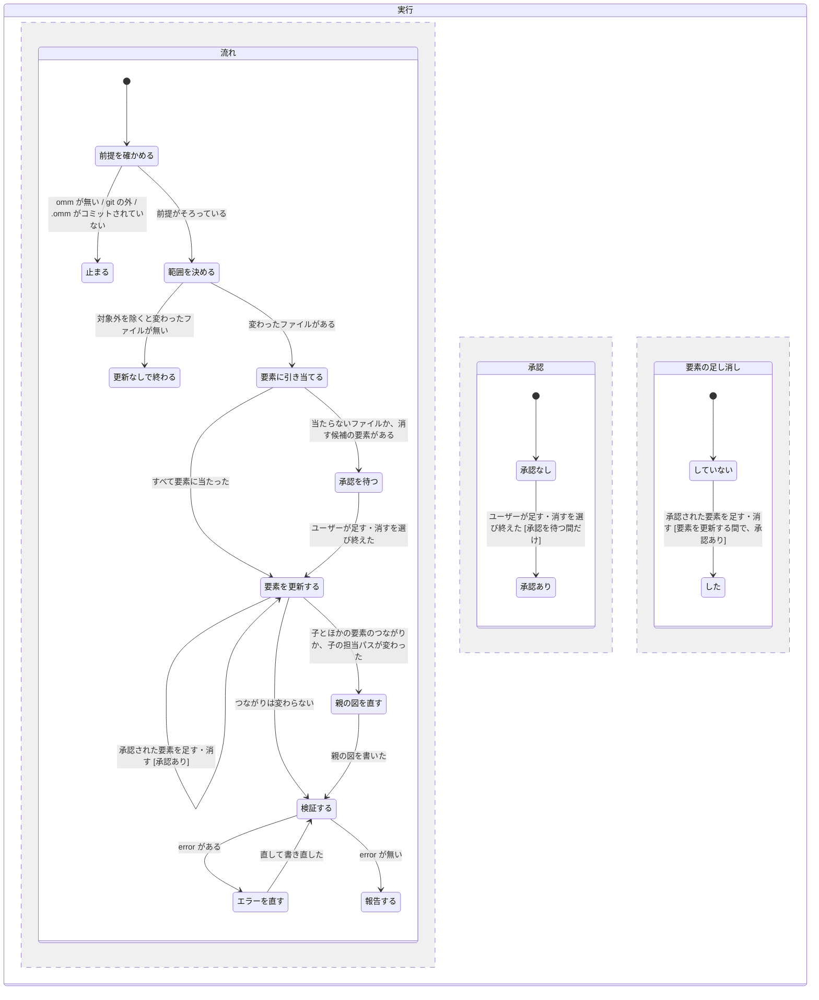

# omm-pr-scan 仕様 (v1)

状態: Ready (2026-10-28、状態の図にユーザーが合意。同日、最終レビューの C1・C2・M1 を受けて、担当パスの書き換え先・図を書く単位・範囲の向き先・検証の範囲を補った)

oh-my-mermaid (omm v0.2.0) の `.omm/` を、PR で変わった範囲だけ更新するラッパースキル。

## 用語

- **視点**: `.omm/` 直下の最上位の要素 (`overall-architecture`、`data-flow` など)。
- **要素**: 視点の中の 1 ノード。`.omm/` の中では 1 つのフォルダで、図のノード ID とフォルダ名が一致する。
- **担当パス**: 要素の図のラベル 2 行目に書かれたパス。末尾が `/` ならフォルダ、それ以外はファイル。1 つのラベルに複数のパスがあれば、カンマで区切られている。
- **差分の範囲**: 更新の対象にする変更。既定は、PR の向き先との分岐点から HEAD まで。
- **対象外**: 構成に関わらないため、範囲に入っても対応づけないファイル。

## Problem Statement

`/omm-scan` は、毎回コードベース全体を読み直して `.omm/` を作る。PR を出すたびに全体を回すとトークンと時間がかかるうえ、変わっていない要素まで書き直されることがある。そうなると、PR で構成のどこが変わったかを図の差分から読み取れない。omm v0.2.0 には範囲を指定する機能がない。`omm diff` も直前の 1 版としか比べられないため、1 回の更新で同じ図を何度も書くと、更新前の図と比べられなくなる。

## Solution

`/omm-pr-scan` を打つと、PR で変わったファイルを、それを担当する要素に引き当てる。そして、その要素だけを `omm write` で更新する。どの要素にも当たらないファイルや消えたファイルについては、要素を足す案・消す案を出し、ユーザーが承認したものだけを実行する。最後に `omm validate` を通し、次のものを会話に出す。

- 更新した要素の一覧と、各図の更新前後 (HEAD の図と作業ツリーの図)
- `omm diff` によるノードと矢印の増減
- 当たらなかったファイル
- PR の本文に貼れる要約

`.omm/` の変更は作業ツリーに残すだけで、stage もコミットもしない。

## User Stories

1. As a PR を出す開発者, I want 引数なしで `/omm-pr-scan` を打つだけで PR の範囲の `.omm/` を更新したい, so that 全体のスキャンを待たずに図を最新にできる
2. As a 開発者, I want PR が開いていれば、その向き先 (base) との分岐点から範囲を決めてほしい, so that 向き先が develop 以外の PR でも正しい範囲になる
3. As a 開発者, I want PR が無いときは `develop`、それも無いときは `main` を向き先にしてほしい, so that PR を作る前にも使える
4. As a 開発者, I want `A..B` でコミット範囲を指定したい, so that 過去の変更や特定のコミットだけを反映できる
5. As a 開発者, I want `--working` を付けたときだけ未コミットの変更も範囲に入れたい, so that 作業中の変更を試しに反映できる一方、既定では PR に入る変更だけを見られる
6. As a 開発者, I want `.omm/` がコミットされていないときは、先に `/omm-scan` を回すよう案内して止まってほしい, so that 比べる元の無いまま中途半端な更新が起きない
7. As a 開発者, I want 変わったファイルが、図のラベルに書かれた担当パスで要素に引き当てられてほしい, so that 対応が実行のたびに同じ結果になる
8. As a 開発者, I want 担当パスが重なるときは、一番長く一致する (一番深い) 要素に当ててほしい, so that 親ではなく、本当に関係する子の要素が更新される
9. As a 開発者, I want 同じパスが複数の視点に出てくるときは、当たった視点の要素をすべて更新してほしい, so that 視点のあいだで説明が食い違わない
10. As a 開発者, I want ラベルで決まらないファイルだけ、AI が description を読んで判断してほしい, so that ラベルが粗い要素でも取りこぼしが減る
11. As a 開発者, I want テスト・ドキュメント・ロックファイル・`.github/`・`.omm/`・静的ファイルは最初から対象外にしてほしい, so that 構成に関係ない変更で図が書き換わらない
12. As a 開発者, I want `--exclude <パターン>` で対象外を足したい, so that リポジトリごとの事情に合わせられる
13. As a 開発者, I want どの要素にも当たらないファイルについて、どの親の下にどんな要素を足すかの案を見たい, so that 新しいモジュールを図に入れるかを自分で決められる
14. As a 開発者, I want 要素を足すのは、私が承認したときだけにしてほしい, so that 意図しない要素が図に増えない
15. As a 開発者, I want 名前が変わっただけのファイルは、ラベルと description のパスを書き換えてほしい, so that 移動のたびに要素を作り直さずに済む
16. As a 開発者, I want 担当するファイルが全部消えた要素については、消す案だけを出してほしい, so that 要素を消すかは自分で決められる
17. As a 開発者, I want `omm delete` は、私が承認してから実行してほしい, so that 図の要素が勝手に消えない
18. As a 開発者, I want 当たった要素の description などの項目を、変わったコードに合わせて更新してほしい, so that 説明がコードと食い違わない
19. As a 開発者, I want 子の要素とほかの要素とのつながりが変わったときだけ、親の図を直してほしい, so that 中身だけの変更で上の図が揺れない
20. As a 開発者, I want 1 回の実行で同じ図は 1 度しか書かないでほしい, so that `omm diff` が更新前と更新後を正しく比べられる
21. As a 開発者, I want 最後に `omm validate` が通っていて、error があれば直されていてほしい, so that 壊れた図をコミットしない
22. As a 開発者, I want warning は直さずに報告に載せてほしい, so that omm の誤検知 (矢印のラベルまでノードに数える件) で余計な書き換えが起きない
23. As a 開発者, I want 更新した要素ごとに、HEAD の図と作業ツリーの図を Mermaid のまま並べて見たい, so that 構成がどう変わったかを目で比べられる
24. As a 開発者, I want `omm diff` によるノードと矢印の増減の要約も見たい, so that 図を読まなくても変化の大きさが分かる
25. As a 開発者, I want 当たらなかったファイルと、対象外にしたファイルの数を見たい, so that 取りこぼしが無いかを確かめられる
26. As a PR のレビュアー, I want PR の本文に貼れる短い要約を受け取りたい, so that 構成の変化を PR の説明に載せられる
27. As a 開発者, I want `.omm/` の変更を、stage もコミットもせずに作業ツリーに残してほしい, so that 何をコミットするかを自分で決められる
28. As a 開発者, I want PR へのコメントなど、外へ出す操作はしないでほしい, so that 確かめる前に結果が人目に触れない
29. As a 開発者, I want 対象のファイルが無いときは、何も書かずに「更新なし」と報告して終えてほしい, so that 意味のない書き込みで meta が変わらない
30. As a スキルの保守者, I want 対応づけを、依存パッケージなしの Node のスクリプトにしたい, so that omm の動く環境なら追加の導入なしで動く
31. As a スキルの保守者, I want 対応づけの入出力だけをテストしたい, so that AI が判断する部分に引きずられず、決まった結果を確かめられる

## Implementation Decisions

- **置き場所**: グローバルスキル `omm-pr-scan` として置く (`~/.claude/skills/omm-pr-scan/`)。起動は手動の `/omm-pr-scan` だけ。`create-pr` などには組み込まない。
- **構成**: スキルは 2 つの部分に分ける。
  - **手順書**: 前提の確認、範囲を決める、対応づけの呼び出し、要素の更新、検証、報告の順を書く。
  - **対応づけスクリプト (map-changes)**: パスと要素を機械的に対応づける。依存パッケージは使わず、Node だけで動かす。
- **対応づけスクリプトの入出力**:
  - 入力:
    - `.omm/` のフォルダ
    - 変わったファイルの一覧 (git の name-status 形式。追加・変更・削除・名前変更の別と、名前変更なら前後のパス)
    - 追加の除外パターン
  - 出力 (JSON):
    - `matched`: ファイルごとの、当たった要素のパス (視点ごとに 0〜1 個、複数の視点にまたがってよい)
    - `renamed`: 名前変更で担当パスの書き換えが要る要素と、前後のパス
    - `unmatched`: どの要素にも当たらないファイル
    - `deletionCandidates`: 担当パスが全部消えた要素
    - `excluded`: 対象外にしたファイルの数
- **担当パスの読み取り**: 各要素の図のノードのラベルから、2 行目 (`\n` の後) をパスとして読む。カンマで区切られた複数のパスを受ける。パスでない文字列 (`(外部・決済)` など) は捨てる。末尾が `/` のパスはフォルダとして前方一致、それ以外はファイルとして完全一致で比べる。
- **当て方**: 変わったファイルを視点ごとに比べ、一番長く一致した担当パスを持つ要素に当てる。どの視点でも当たらなければ `unmatched` に入れる。`unmatched` について description を読んで判断するのは手順書の側 (AI) で、スクリプトはしない。
- **既定の対象外**:
  - テスト (`*.test.*`・`*.spec.*`・`__tests__/`・`e2e/`)
  - ドキュメント (`*.md`・`docs/`)
  - ロックファイル、`.github/`、`.omm/`
  - 画像・フォントなどの静的ファイル
- **範囲の決め方**:
  1. 引数に `A..B` があればそれを使う。
  2. 無ければ、開いている PR の向き先を `gh pr view` で取る。
  3. PR が無ければ `develop`、それも無ければ `main` を向き先にする。
  4. 向き先と HEAD の分岐点から HEAD までを範囲にする。向き先はリモートの追跡ブランチ (`git fetch origin <base>` のあとの `origin/<base>`) を優先し、無いときだけローカルのブランチを使う。ローカルの向き先が古いと、他人の変更まで範囲に入るため。
  5. `--working` があれば、未コミットの変更を足す。
- **前提の確認**: 次のどれかに当たれば、案内を出して止まる。
  - `omm` が無い
  - git リポジトリでない
  - `.omm/` が HEAD に無い
- **書き込みの決まり**:
  - 1 回の実行で、同じ要素の同じ項目は 1 度しか `omm write` しない。図は図のファイル (`diagram.mmd`) ごとに 1 度だけ書く。書く前に、その図に入る変更 (子の担当パスの書き換え・ノードの増減・矢印) をすべて集めて内容を決めきる。
  - 要素の担当パスは、その要素自身ではなく親の図のノードのラベルに書かれている。名前変更・削除で担当パスを書き換えるときは、親の図のラベルを直す。
  - 要素を足す (`unmatched` から) ことと消す (`deletionCandidates`) ことは、案をまとめてユーザーに一度に聞き、承認されたものだけ実行する。
  - 名前変更は承認なしで、ラベルと description のパスを書き換える。
- **親の図**: 子の要素を更新したとき、子とほかの要素とのつながり (矢印・ノードの増減) が変わったと AI が判断した場合と、子の担当パス (親の図のラベル) が変わった場合だけ、親の図を書き直す。
- **検証**: 最後に、書いた図ごとに `omm validate <要素パス>` を回す (引数なしの `omm validate` は視点の図しか見ない)。error があれば該当の項目を直す。直すために同じ図を書き直すのは、検証に失敗したときに限り 1 回の例外として認め、報告にその旨を書く。warning は報告に載せるだけにする。
- **報告**: 会話にだけ出し、PR へのコメントなど外へ出す操作はしない。載せるものは次のとおり。
  - 範囲 (向き先・分岐点・HEAD)
  - 更新した要素の一覧
  - 書いた図のファイルごとの更新前 (HEAD) と更新後 (作業ツリー) の Mermaid
  - `omm diff` の増減
  - 当たらなかったファイル、対象外にした数
  - validate の結果
  - PR の本文に貼れる要約
- **しないこと**: stage・コミット・push・`omm push` などのクラウド操作・`omm view` の起動。

## Testing Decisions

- **合意済みの seam**: 対応づけスクリプト (map-changes) の入出力だけ。入力は `.omm/` のフォルダ、変わったファイルの一覧、除外パターンで、出力は JSON。
- **よいテストとは**: スクリプトを外から呼び、渡した `.omm/` の見本と変更の一覧に対して、JSON の中身を確かめる。内部の関数は直接呼ばない。
- **テストする場面**:
  - 担当パスが重なるときに一番深い要素に当たること
  - 複数の視点に当たること
  - フォルダのパスとファイルのパスの比べ方の違い
  - 1 つのラベルに複数のパスがあるとき
  - パスでないラベルを捨てること
  - 既定の対象外と `--exclude`
  - 名前変更、全部消えた要素の検出
  - どこにも当たらないファイル
  - 対象が 0 件のとき
- **道具**: `node --test`。見本の `.omm/` は、テストの中で一時フォルダに作る。
- **テストしないもの**: 手順書の側で AI が判断する部分 (description の書き直し、親の図を直すかの判断、要素を足す案の中身)。

## Out of Scope

- `create-pr`・`review-changes` などへの組み込みや、自動での起動
- PR へのコメントや、GitHub Actions での実行
- 要素とファイルの対応表を `.omm/` に足すこと (omm の形式は変えない)
- `/omm-scan` の作り直し、omm 本体への変更
- 視点を新しく作ること (v1 では既存の視点の中だけを更新する)
- `.omm/` の stage・コミット

## Further Notes

- omm v0.2.0 の `omm validate` は、空白を含む矢印のラベルまでノードとして数え、ノード数の warning を出す。誤検知なので直さない。
- omm の ROADMAP に「Incremental analysis」が載っている。本体に範囲指定が入ったら、このスキルを畳むか作り直すかを見直す。
- meta.yaml の `git_commit` は書き込んだ時点の HEAD で、範囲の決め方には使わない。

## 状態の図

流れ・承認・要素の足し消しの 3 つを、別々に動く領域として描く。承認は「承認を待つ」の間だけ受け付ける。要素の足し消しは「要素を更新する」の間に、承認があるときだけ行う。

**検査の結果** (pstack `/statechart` from-chart、TLC 1.7.4):

- 最初の図は、承認と足し消しが流れと関係なく起きうる形で、規則が 2 つ破れていた。「止まる」や「更新なしで終わる」に着いたあとでも、承認から足し消しへ進めてしまう。
- 承認を「承認を待つ間だけ」、足し消しを「要素を更新する間で、承認あり」に限ったあとは、21 状態・27 遷移で 4 つの規則 (型の規則と上の 3 つ) がすべて通った。
- 検査に使った図は TLA+ の都合で状態名を英語の ID にしているが、上の図と同じ形をしている。

**この図で検査していない決まり**: 次の 3 つは、図の上に「それをする」遷移が無いため、検査の対象にならない。手順書の側で守る。

- error を直すとき以外に、1 回の実行で同じ図を 2 度書かない。
- `.omm/` の変更を stage・コミットしない。
- 結果を PR など外へ出さない。
